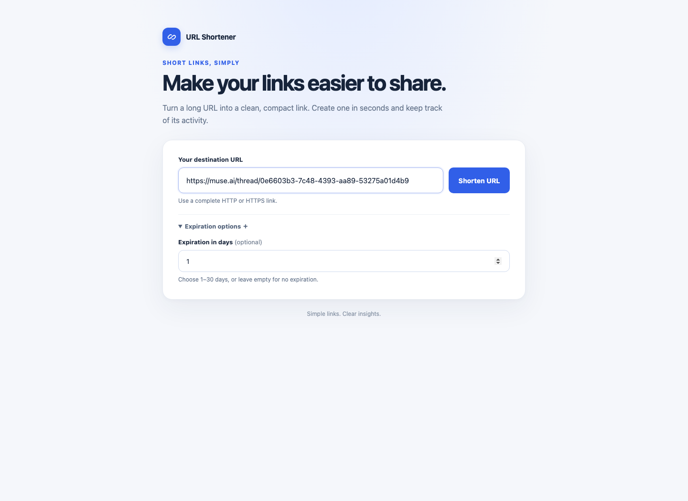
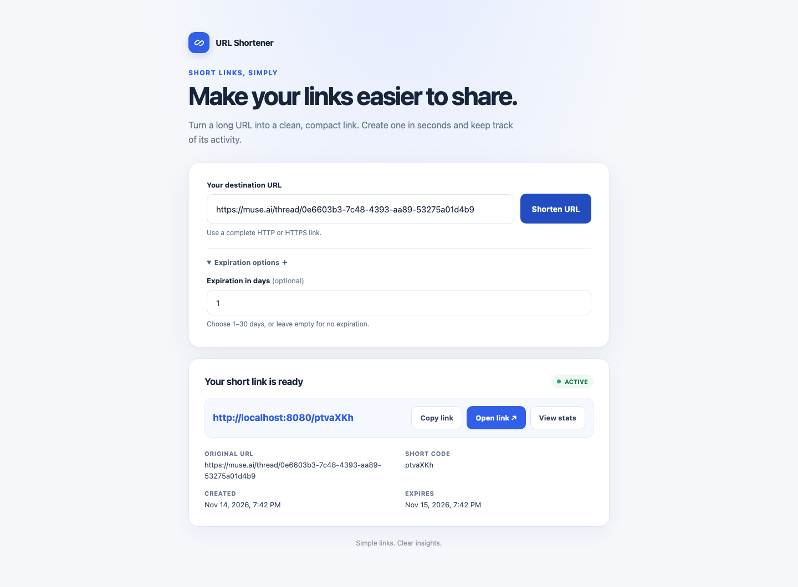
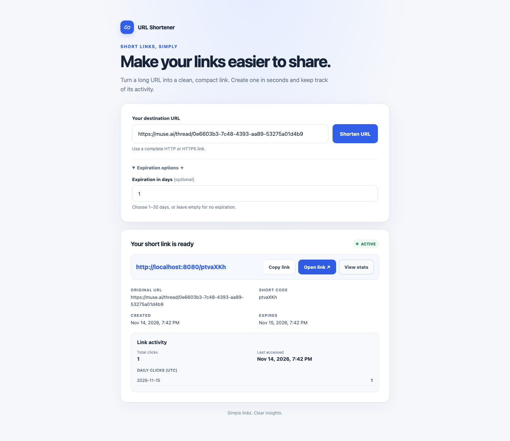

# Interview Assignment: Build an Agentic Software Engineering System — URL Shortener

This repository contains a Spring Boot URL shortener and a Python/LangGraph engineering orchestrator. The orchestrator works in isolated Git worktrees and produces auditable, human-reviewed engineering outcomes. Assignment requirements and the section order below follow [the supplied assignment PDF](docs/Assignment_Agentic-Proficient_Software_Engineer.pdf).

## 1. Objective

> Build a working prototype that transforms a requirement into a reviewable engineering outcome using an agentic execution model. Demonstrate requirement understanding, task decomposition, multi-step execution, and output generation/validation. Focus on end-to-end SDLC automation with controlled autonomy.

The Java service is the application being engineered. The orchestrator demonstrates how a request can become structured requirements, a dependency-aware plan, an approved patch in a Git worktree, real test evidence, review, documentation, and a release-readiness report. It does not automatically merge, commit, push, or deploy the result.

## 2. Scenario

The assignment scenario is to build a URL shortener service from scratch with core APIs, analytics, and reliability features. It frames completion and improvement as a 2–3 day effort using AI assistance (for example, Copilot or Claude) while demonstrating engineering judgment.

The repository has two parts:

- **URL shortener:** Java 21, Spring Boot 3.5.4, Maven, PostgreSQL 16, Spring Data JPA, Flyway, Validation, Actuator, and OpenAPI. The application listens on port 8080 and serves the browser UI at `/`.
- **Agentic engineering system:** Python 3.11+, LangGraph, Pydantic, SQLite-backed checkpoints/audit records, a CLI-first interface, optional minimal FastAPI, Git worktrees, FakeLLM fixtures, and an Ollama provider for local inference.

The demonstrated engineering scenarios are:

| Scenario | Engineering change or decision | Human-operated run |
|---|---|---|
| Greenfield | Add custom URL aliases, collision handling, migration, and regression coverage | `34a6434bf2c9` — READY |
| Brownfield | Archive expired links on a schedule while preserving mappings, clicks, and `410 URL_EXPIRED` behavior | `7a3c0bb800e2` — READY |
| Ambiguous requirement | Clarify “Improve URL security and expiration”; the recorded decision sets a 30-day maximum and archives while preserving mappings and click statistics | `2f72a083f296` — READY |

These scenario changes remain in their separate worktrees for review; they have not been merged into the root Java application. A separate Ollama-backed brownfield run, `d80be97dedbe`, reached READY after real Maven/Testcontainers verification. Final readiness was approved after human review of the diff and test evidence.

## 3. Scope

The assignment scope is:

- Greenfield scenarios (new systems/features)
- Brownfield scenarios (enhancements, refactors, bug fixes)
- Test and documentation improvements
- Well-defined and ambiguous requirements

The greenfield, brownfield, and ambiguous demonstrations above cover these scenario types. A separate `retry_rollback` fixture demonstrates bounded test retries and an explicitly approved rollback. The Java backend and the orchestrator are documented independently so a reviewer can inspect application behavior and workflow evidence separately.

## 4. Core Requirements

The assignment defines the following core requirements and this repository addresses them as follows.

1. **Requirement Understanding:** Interpret intent, identify ambiguity, normalize into a clear engineering problem.

   The Requirement Agent produces structured requirements and acceptance criteria. The ambiguous scenario pauses for operator clarification and records the answer and its provenance before planning continues.

2. **Task Decomposition:** Convert high-level requirements into actionable tasks with dependencies and sequencing.

   The Planning Agent produces a validated task DAG with dependencies, affected files, risks, and decisions. The graph schedules dependent coding tasks and joins parallel validation/review/documentation work at synchronization barriers.

3. **Codebase Reasoning (Brownfield):** Identify impacted modules/services/APIs/data flows and demonstrate architectural understanding.

   Planning reads the existing repository and identifies affected Java, migration, test, and documentation files. The brownfield archival workflow preserves the existing redirect and analytics behavior and validates changes against PostgreSQL.

4. **Workflow Orchestration (Critical Differentiator):** Design and implement an agentic orchestration layer that coordinates the full SDLC lifecycle across requirements, architecture/design, implementation, testing, documentation, release readiness, and demonstrates non-linear, stateful execution with governance rather than simple linear task chaining. The orchestration must use an explicit dependency graph with entry/exit gates, support sequential and parallel paths with synchronization, preserve cross-stage context and decision lineage, enforce human approval checkpoints for high-impact actions, and include bounded retries, recovery, rollback, and safe-stop controls. It must also embed policy guardrails for security, compliance, and change control, provide audit-grade observability and traceability, track reliability metrics such as success rate, retry/rollback frequency, MTTR, and end-to-end latency, and dynamically re-plan when upstream outputs change while maintaining governance and controlled agent autonomy.

   LangGraph checkpoints persist workflow state and interrupts in SQLite. Plan, patch/schema/Maven execution, rollback, and final readiness decisions are separate gates. Allowlisted Maven execution, worktree/path restrictions, bounded retries, journaled restoration, and safe-stop handling are enforced by the workflow and tools. Run folders contain approvals, decisions, audit events, diffs, test evidence, reports, and metrics. See [orchestrator architecture](orchestrator/docs/architecture.md) and [governance](orchestrator/docs/governance.md).

5. **Engineering Output Generation:** Produce production-quality code, API/schema definitions, unit/integration tests, and supporting documentation with clean design and maintainability.

   The root Java application includes its API, PostgreSQL schema migrations, tests, and documentation. The Coding Agent proposes complete file changes in an isolated worktree; approved patches are applied only after explicit operator approval. Maven validation uses actual test reports. FakeLLM is deterministic fixture behavior, not model inference; Ollama is a separately configured local provider.

6. **Validation and Risk Control:** Identify risks/trade-offs/failure scenarios and define validation and safety guardrails.

   Validation includes unit/HTTP tests and PostgreSQL Testcontainers integration tests. The orchestrator classifies failures, caps repair retries, records real command results, and requires approval before rollback. Risk and trade-off notes are in [backend design decisions](docs/design-decisions.md) and [orchestrator governance](orchestrator/docs/governance.md).

7. **Controlled Autonomy:** Agents execute multi-step work; humans provide oversight, approvals, and final quality control.

   The CLI pauses at explicit approval and clarification gates. An approval is tied to the inspected proposal/hash and actor. There is no automatic approval or automatic merge/deploy path. See [orchestrator setup and CLI workflow](orchestrator/README.md).

8. **Final Engineering Summary:** Include plan/rationale, artifacts, risks/trade-offs/validation, assumptions, and limitations.

   Each completed run records its plan, decisions, audit trail, code changes, actual test result, metrics, review, and release-readiness report under `orchestrator/runs/<RUN_ID>/`.

## 5. Deliverables

The assignment deliverables and the corresponding project artifacts are listed below.

### Working prototype (runnable end-to-end)

The Java API and one-page UI run with PostgreSQL through Docker Compose. The Python orchestrator is in the same repository under `orchestrator/`.

Prerequisites for the backend are Docker with Compose. From the repository root:

~~~bash
docker compose up -d
docker compose ps
curl --fail http://localhost:8080/actuator/health/readiness
bash scripts/smoke-test.sh
~~~

Open the UI at <http://localhost:8080/>. Swagger UI is at <http://localhost:8080/swagger-ui/index.html>; OpenAPI JSON is at <http://localhost:8080/v3/api-docs>. Compose publishes the application on loopback port 8080 and PostgreSQL on host port 5433.

The Java service reads `DATABASE_URL`, `DB_USER`, `DB_PASSWORD`, and `BASE_URL`. Compose supplies local demonstration defaults; use environment-specific credentials outside local development. See [.env.example](.env.example) and [configuration and behavior](docs/design-decisions.md).

For a concise overview of the application and orchestrator, see the [project description](docs/project-description.md).

The one-page UI is available at <http://localhost:8080/>. The screenshot below shows its starting page.

#### Frontend fields and components

- **Brand and introduction:** identifies the URL Shortener and explains its purpose.
- **Your destination URL:** required field for a complete HTTP or HTTPS address. The browser checks the URL format before sending it to the API.
- **Expiration options:** expandable optional field. Enter a whole number from 1 to 30 days; leave it blank if the link should not expire.
- **Shorten URL:** submits the form. The button shows a loading state while the request is processed, and validation or API errors appear beside the form.
- **Result card:** shows the generated short URL, active status, original address, short code, creation time, and expiration time.
- **Copy link:** copies the short address and briefly changes its label to “Copied”.
- **Open link:** opens the short address in a new tab. The backend responds with HTTP 302 to the saved destination and records the click.
- **View stats:** fetches and displays total clicks, last accessed time, and daily clicks in UTC.

The current frontend does not offer custom aliases. To run the page locally, start Docker Compose from the repository root with `docker compose up -d`, then visit <http://localhost:8080/>. The readiness check and other setup commands are listed above.

#### Step-by-step shortening walkthrough

The following browser screenshots use the [Muse.ai thread link provided for this walkthrough](https://muse.ai/thread/0e6603b3-7c48-4393-aa89-53275a01d4b9) as the destination. In this captured run, the optional expiration was set to one day and the generated short code was `ptvaXKh`.

1. **Enter the destination and optional expiration.** Paste the complete Muse thread URL. Expand **Expiration options** to set a 1–30 day lifetime, or leave it empty for no expiration.

   

2. **Create the short link.** Select **Shorten URL**. The page sends the URL and optional expiration to `POST /api/v1/urls`, then displays the result card with its short link and metadata.

   

3. **Copy the result.** Select **Copy link**. The button confirms the action by showing “Copied”.

   

4. **Open the link and check activity.** Select **Open link** to follow the short address; the redirect returns HTTP 302 and records a click. Select **View stats** to see total clicks, the last access time, and daily activity. In this run the page showed `totalClicks=1`.

   

Headless Chromium completed this flow against the running application: `GET /` returned 200, creation succeeded, the Open link action received a 302 redirect, and stats reported one click. These screenshots document the browser interaction; the Muse thread itself is linked as the destination and its content is not reproduced here.

### Architecture overview (components, orchestration model, control flow, key decisions)

- [Backend components, database schema, transactions, and observability](docs/architecture.md)
- [Backend reliability, security, scalability, and design decisions](docs/design-decisions.md)
- [LangGraph state, dependency graph, persistence, and recovery](orchestrator/docs/architecture.md)
- [Approval, security, and rollback controls](orchestrator/docs/governance.md)

### Three scenarios: greenfield, brownfield, ambiguous (each shows decomposition, orchestration, validation)

Run folders preserve the plans, decisions, approvals, worktree diffs, test results, audits, and metrics for each human-operated scenario. Scenario descriptions and evidence are in [scenario walkthroughs](orchestrator/docs/scenarios.md) and [orchestrator test/evidence results](orchestrator/docs/testing.md).

| Demonstration | Run ID | Result |
|---|---|---|
| Greenfield custom aliases | `34a6434bf2c9` | READY; real Maven/PostgreSQL validation |
| Brownfield expiration archival | `7a3c0bb800e2` | READY; real Maven/PostgreSQL validation |
| Ambiguous security/expiration request | `2f72a083f296` | READY after recorded clarification and real Maven/PostgreSQL validation |
| Ollama brownfield archival | `d80be97dedbe` | READY; qwen2.5-coder:7b, real Maven/PostgreSQL validation |

The deterministic `retry_rollback` acceptance scenario deliberately runs a failing Java test, retries within the configured bound, and verifies rollback after a separate approval. It is described in the scenario walkthrough; it is not one of the assignment’s three feature scenarios.

### Setup instructions

To set up the orchestrator, install Python 3.11+, Git, Java 21, Maven 3.9+, and Docker for Testcontainers. From the repository root:

~~~bash
python3 -m venv orchestrator/.venv
orchestrator/.venv/bin/python -m pip install -r orchestrator/requirements.lock
orchestrator/.venv/bin/python -m pip install -e 'orchestrator[test]'
./orchestrator/run doctor
~~~

The CLI is the primary demo. FakeLLM runs deterministic supported fixtures without paid keys or model inference:

~~~bash
./orchestrator/run run greenfield --provider fake
./orchestrator/run inspect RUN_ID
~~~

Review the pending proposal and use its exact approval ID and hash with the `approve` command documented in [the CLI workflow](orchestrator/README.md), then `resume`. Approval gates recur for the concrete patch/Maven scope and final readiness. The ambiguous scenario accepts operator clarification before planning. Ollama with `qwen2.5-coder:7b` is optional and requires a local Ollama server/model; it is not substituted automatically when selected-provider calls fail. See [provider setup and exact commands](orchestrator/README.md#llm-providers).

### Testing approach, limitations, and trade-offs

Run the Java backend suite with Java 21, Maven 3.9+, and Docker available for Testcontainers:

~~~bash
mvn clean verify
~~~

The recorded root build passed with **75 tests: 59 unit/HTTP tests and 16 PostgreSQL integration tests; zero failures, errors, or skips**. Integration tests use PostgreSQL 16 through Testcontainers and Flyway migrations. See [backend testing and results](docs/testing.md).

The orchestrator has deterministic unit tests and CLI acceptance scenarios that execute real Maven/Testcontainers in isolated worktrees. Its currently documented evidence includes 58 non-Maven Python tests, four Maven CLI acceptance tests, three READY human-operated scenarios, and a deliberate retry/rollback scenario. The Ollama-backed archival run reports 62 unit/HTTP plus 23 PostgreSQL integration tests. See [orchestrator test results and evidence limits](orchestrator/docs/testing.md); these suites have separate counts and are not additive to the root Java build count.

Known trade-offs and limits include synchronous durable click-event writes, unbounded event retention, per-process in-memory rate limits, no Phase 1 authentication, local prototype execution, and scenario changes isolated in worktrees pending separate integration. Functional tests do not establish production load capacity, a security audit, backup/restore, or deployment readiness. Review and documentation for the Ollama run were completed by human review of the approved patch and test evidence.

Useful API routes:

| Method | Path | Behavior |
|---|---|---|
| POST | `/api/v1/urls` | Create a short URL; returns 201 |
| GET | `/{code}` | Record a click and return 302 with `Location` |
| GET | `/api/v1/urls/{code}` | Read URL information |
| GET | `/api/v1/urls/{code}/stats` | Read total and UTC daily click statistics |
| PATCH | `/api/v1/urls/{code}/disable` | Disable a URL; later redirects return 410 |

Create a link:

~~~bash
curl -i -X POST http://localhost:8080/api/v1/urls \
  -H 'Content-Type: application/json' \
  -d '{"originalUrl":"https://www.example.com/some/long/page"}'
~~~

Use the returned short code for redirect and stats checks. The complete asserted lifecycle is available as `bash scripts/smoke-test.sh`; detailed payloads and error responses are in [API examples](docs/api-examples.md).

## 6. Evaluation Criteria

The assignment evaluation criteria are:

- Effectiveness of agentic orchestration
- Architecture/system design quality
- Depth of decomposition and execution quality
- Realism/quality of outputs
- Validation and risk management rigor
- Clarity and defensibility of decisions
- Core engineering principles: modular, testable, reliable, secure, scalable code with safe change management
- Engineering judgment

For evidence, see the graph and state model in [orchestrator architecture](orchestrator/docs/architecture.md), approval and recovery boundaries in [governance](orchestrator/docs/governance.md), per-scenario artifacts in [scenario walkthroughs](orchestrator/docs/scenarios.md), and executed results/limitations in [orchestrator testing](orchestrator/docs/testing.md).

## 7. Expectation

Treat this as production-grade engineering work. Demonstrate strong design fundamentals, lifecycle orchestration capability, output ownership, and defensible reasoning. Principle: **Agents execute under defined autonomy boundaries; humans own oversight, approvals, and final quality.**
